<a href="https://assoli.site">
  <picture>
    <source media="(prefers-color-scheme: dark)" srcset="assets/hero-dark.svg">
    <source media="(prefers-color-scheme: light)" srcset="assets/hero-light.svg">
    
  </picture>
</a>

  I take an idea from the first sketch to a live app on the web, the App Store and Google&nbsp;Play, 
  and I keep it running after launch.

  <a href="https://assoli.site/en/projects"><picture><source media="(prefers-color-scheme: dark)" srcset="assets/btn-work-dark.svg"><source media="(prefers-color-scheme: light)" srcset="assets/btn-work-light.svg"></picture></a>
  &nbsp;
  <a href="https://assoli.site/en/hire-me"><picture><source media="(prefers-color-scheme: dark)" srcset="assets/btn-hire-dark.svg"><source media="(prefers-color-scheme: light)" srcset="assets/btn-hire-light.svg"></picture></a>

<picture>
  <source media="(prefers-color-scheme: dark)" srcset="assets/tape-dark.svg">
  <source media="(prefers-color-scheme: light)" srcset="assets/tape-light.svg">
  
</picture>

 

  <picture><source media="(prefers-color-scheme: dark)" srcset="assets/h-now-dark.svg"><source media="(prefers-color-scheme: light)" srcset="assets/h-now-light.svg"></picture>

<table>
  <tr>
    <td width="30%"><b>GoldenTik</b> Software engineer, since 2026</td>
    <td>Multi-vendor online stores: NestJS services that hold up when many sellers work at once, Next.js storefronts and a React Native app on one API.</td>
  </tr>
  <tr>
    <td><b><a href="https://assoli.site/en/projects/malabji">Malabji</a></b> Founder, since 2025</td>
    <td>Book a football pitch, find players and play. I run product, design, the app, the backend, store releases and support. On <a href="https://apps.apple.com/jo/app/id6744635501">iOS</a> and <a href="https://play.google.com/store/apps/details?id=com.haithamassoli.malabji">Android</a>.</td>
  </tr>
  <tr>
    <td><b>Freelance</b> Since 2022</td>
    <td>Products for municipalities, tourism, education, charities and e-commerce in Jordan and Saudi Arabia.</td>
  </tr>
</table>

Before this: research tools for 8,000+ scientists at Bionl.Ai, dashboards at Repzo, and a traineeship at Orange Jordan.

 

  <picture><source media="(prefers-color-scheme: dark)" srcset="assets/h-work-dark.svg"><source media="(prefers-color-scheme: light)" srcset="assets/h-work-light.svg"></picture>

Six recent projects and the problem each one solves.

<table>
  <tr>
    <td width="30%"><b><a href="https://assoli.site/en/projects/aoun">Aoun</a></b> Web, 2026</td>
    <td>A free academic platform for Jordanian university students. Summaries, past exams and GPA tools in one place, and it works offline.</td>
    <td width="16%"><a href="https://aoun.assoli.site">Website</a> <a href="https://github.com/haithamassoli/aoun">Source</a></td>
  </tr>
  <tr>
    <td><b><a href="https://assoli.site/en/projects/kashaf-alkulify">Kashaf Abi Ja'far</a></b> Web, 2026</td>
    <td>Search thousands of hours of Arabic lessons and land on the exact second they were said. No login and no database.</td>
    <td><a href="https://alkulify.assoli.site">Website</a> <a href="https://github.com/haithamassoli/kashaf-alkulify">Source</a></td>
  </tr>
  <tr>
    <td><b><a href="https://assoli.site/en/projects/pastehtml">pastehtml</a></b> Web, 2026</td>
    <td>Drop an HTML file and get a shareable link in seconds, from the browser, the terminal or an AI agent over MCP.</td>
    <td><a href="https://pastehtml.assoli.site">Website</a> <a href="https://github.com/haithamassoli/pastehtml">Source</a></td>
  </tr>
  <tr>
    <td><b><a href="https://assoli.site/en/projects/naqi">Naqi</a></b> On-device AI, 2026</td>
    <td>Removes music and blurs imagery in a video, entirely on your phone. No cloud, no account, no tracking.</td>
    <td><a href="https://play.google.com/store/apps/details?id=com.haithamassoli.naqi">Google Play</a> <a href="https://github.com/haithamassoli/NaqiHalalVideoFilter">Source</a></td>
  </tr>
  <tr>
    <td><b><a href="https://assoli.site/en/projects/azkari">Azkari</a></b> Desktop and watch, 2023 to 2026</td>
    <td>One remembrance every so often, on whichever screen you are at: VS Code, macOS, Windows, Apple Watch and Wear OS.</td>
    <td><a href="https://marketplace.visualstudio.com/items?itemName=HaithamAssoli.azkari">VS Code</a> <a href="https://github.com/haithamassoli/Azkari">Source</a></td>
  </tr>
  <tr>
    <td><b><a href="https://assoli.site/en/projects/eecommittee">EECommittee</a></b> Mobile, since 2022</td>
    <td>Every resource an electrical engineering student needs, in one place. Volunteer work, still serving students years later.</td>
    <td><a href="https://play.google.com/store/apps/details?id=com.haithamassoli.EECommitte">Google Play</a> <a href="https://github.com/haithamassoli/EECommitte-App">Source</a></td>
  </tr>
</table>

<a href="https://assoli.site/en/projects">Browse all 45 projects on assoli.site</a>

 

  <picture><source media="(prefers-color-scheme: dark)" srcset="assets/h-toolbox-dark.svg"><source media="(prefers-color-scheme: light)" srcset="assets/h-toolbox-light.svg"></picture>

<table>
  <tr><td width="30%"><b>Languages</b></td><td>TypeScript, JavaScript, Swift, Kotlin, Python, PHP</td></tr>
  <tr><td><b>Web</b></td><td>React, Next.js, Astro, Tailwind CSS, Motion, TanStack Query</td></tr>
  <tr><td><b>Mobile</b></td><td>React Native, Expo, Reanimated, Skia, SwiftUI, Jetpack Compose</td></tr>
  <tr><td><b>Backend</b></td><td>Node.js, NestJS, Hono, Express, Laravel, Convex, Prisma</td></tr>
  <tr><td><b>Data</b></td><td>PostgreSQL, MySQL, MongoDB, Redis, Supabase, Firebase, Meilisearch</td></tr>
  <tr><td><b>On-device AI</b></td><td>ONNX Runtime, transformers.js, Whisper, Demucs</td></tr>
  <tr><td><b>Shipping</b></td><td>AWS, Docker, Vercel, EAS, CI/CD, Linux</td></tr>
  <tr><td><b>Craft</b></td><td>Figma, accessibility, Arabic and RTL, SEO, performance</td></tr>
</table>

 

  <picture><source media="(prefers-color-scheme: dark)" srcset="assets/h-hours-dark.svg"><source media="(prefers-color-scheme: light)" srcset="assets/h-hours-light.svg"></picture>

<a href="https://wakatime.com/@haithamassoli">
  <picture>
    <source media="(prefers-color-scheme: dark)" srcset="assets/stats-dark.svg">
    <source media="(prefers-color-scheme: light)" srcset="assets/stats-light.svg">
    
  </picture>
</a>

Hours from WakaTime, contributions from GitHub. Redrawn every morning.

 

  <a href="https://assoli.site"><picture><source media="(prefers-color-scheme: dark)" srcset="assets/signature-dark.svg"><source media="(prefers-color-scheme: light)" srcset="assets/signature-light.svg"></picture></a>

  Open to collaborating on open-source projects that fit my stack. 
  <a href="mailto:haitham.b.assoli@gmail.com">haitham.b.assoli@gmail.com</a>

  <a href="https://assoli.site">Portfolio</a>&emsp;
  <a href="https://cv.assoli.site">CV</a>&emsp;
  <a href="https://www.linkedin.com/in/haithamassoli/">LinkedIn</a>&emsp;
  <a href="https://dev.to/haithamassoli">DEV</a>&emsp;
  <a href="https://wakatime.com/@haithamassoli">WakaTime</a>

